# Trip Brochure — the handbook

An offline itinerary app for a family trip, made to look and feel like a beautifully printed travel brochure, with
every confirmation (emails, tickets, screenshots) built in so nothing needs the network. It runs on Android phones,
iPhones and iPads. Updates go to the phones over the air while you are still planning, and even during the trip.

This handbook is written for someone building their own version with help from a Claude agent. It covers the whole
thing: what the app does (with screenshots), how it is put together, how to describe your own trip, which optional
pieces need which accounts, and, step by step, how to get it onto phones, including installing Xcode and setting up an
Apple developer account if you go the native-app route. Nothing here is mandatory beyond the core; each optional piece
says what it adds and what it costs, so you can leave out anything you do not want.

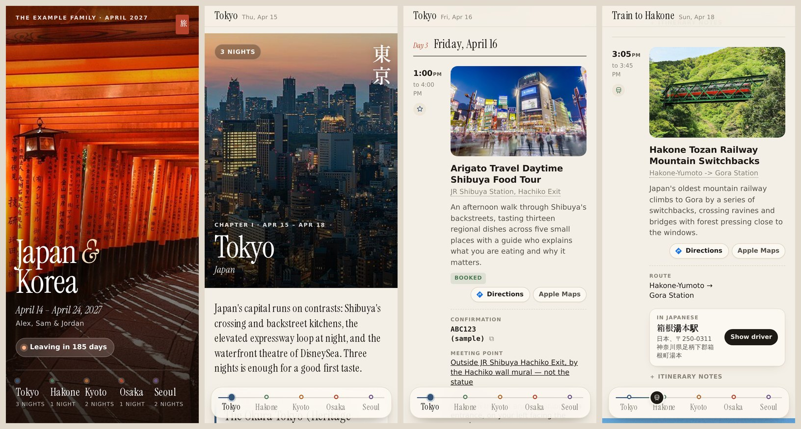

**Contents**

1. [What it is](#1-what-it-is)
2. [A tour of the app](#2-a-tour-of-the-app)
3. [How it is put together](#3-how-it-is-put-together)
4. [Run the sample in five minutes](#4-run-the-sample-in-five-minutes)
5. [Describe your own trip](#5-describe-your-own-trip)
6. [Optional pieces: Claude and Google Maps](#6-optional-pieces-claude-and-google-maps)
7. [Getting it onto phones](#7-getting-it-onto-phones)
   - [Route A: as a web app (Android, iPhone, iPad; no developer account)](#route-a-as-a-web-app)
   - [Route B: as a native iOS app (Xcode, Apple developer account)](#route-b-as-a-native-ios-app)
   - [Route C: a native Android app](#route-c-a-native-android-app)
8. [Updating it, before and during the trip](#8-updating-it-before-and-during-the-trip)
9. [The design, and the rules that keep it looking this way](#9-the-design-and-the-rules-that-keep-it-looking-this-way)
10. [Making it yours: customising and riffing](#10-making-it-yours-customising-and-riffing)
11. [Troubleshooting](#11-troubleshooting)
12. [Credits, licences, costs](#12-credits-licences-costs)
13. [A start-here checklist for your Claude agent](#13-a-start-here-checklist-for-your-claude-agent)

---

## 1. What it is

The app is one static web page (`index.html`, a stylesheet, a script, a data file, photographs, documents, fonts).
Everything it shows is inside that folder, so it works with the phone in airplane mode. Two things make it feel like an
app rather than a web page:

- **A shell.** Either the phone's own "Add to Home Screen" (a *web app*: the page installs like an app, with an icon,
  full screen, and a small background script that keeps every file on the phone), or a tiny native iOS wrapper we
  wrote in Swift (a *native app*: installed like any app, updated over the air). Both show exactly the same page.
- **A builder.** A Python script turns a folder describing your trip (`trip.json` plus photos and documents) into that
  static folder, resizing photographs, rendering PDFs and emails into pages, and writing a version number so phones
  know when something changed.

Between those sit some optional helpers: Claude writes the brochure copy (a short blurb and the key facts for every
city, hotel and event), translates confirmations in other languages into English, and reads a confirmation to fill the
itinerary; Google Maps pins each place exactly and draws a small offline map of it. Each of these needs an API key and
costs cents; each can be skipped.

The sample trip in `sample/` is a real eleven-day Japan and Korea itinerary with the personal details replaced, so you
can build it, open it, and see every feature before you write a line of your own.

---

## 2. A tour of the app

### The cover


A full-screen photograph with a slow, barely visible zoom; the family's name and the month in small capitals; a red
seal (旅, "journey"); the trip's name in a big serif; the dates; who is going; a status pill ("Leaving in 3 days", then
"Day 4 of 11 · Tokyo", then "Welcome home"); and the route: one dot per city, in that city's colour, with the nights.
Tap a city to glide to its chapter.

### The introduction

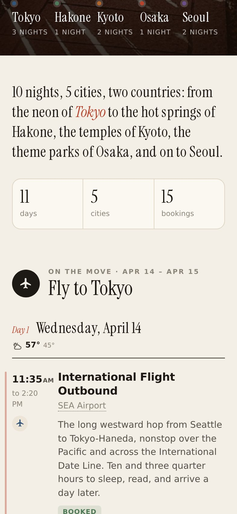

A single paragraph in the serif (you write it), three numbers at a glance (days, cities, bookings), then the first
journey. Journeys are the stretches between cities: "Fly to Tokyo", "Train to Hakone", "Fly home". They get a round
badge with the way of travel and hold the transit events (the flight, the taxi to the station, the airport bus).

### A city chapter

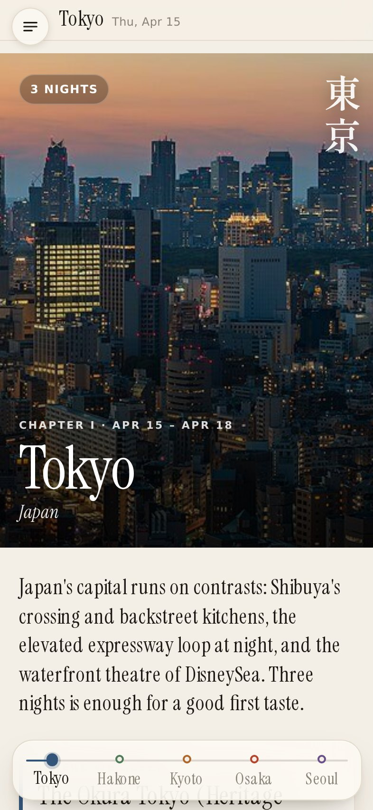

Each city is a chapter: a full-bleed photograph with the city's name large, its country in italics, the chapter number
and dates, a "3 nights" pill, and the name in its own script (東京) down the side. Under it, a paragraph about the city,
then the hotel.

### Where we sleep

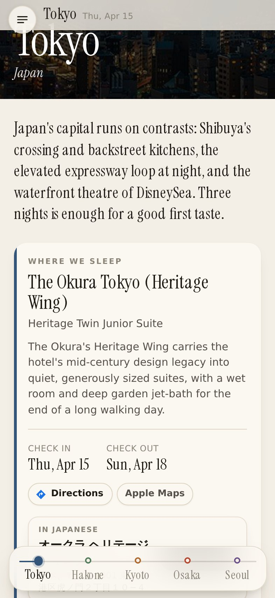

A card with a ribbon in the city's colour: hotel, room, a sentence about it, check-in and check-out dates, a
Directions button, and the facts worth having at the desk (booking platform, perks, confirmation). Below the card come
the days of the stay.

### A day, and its events

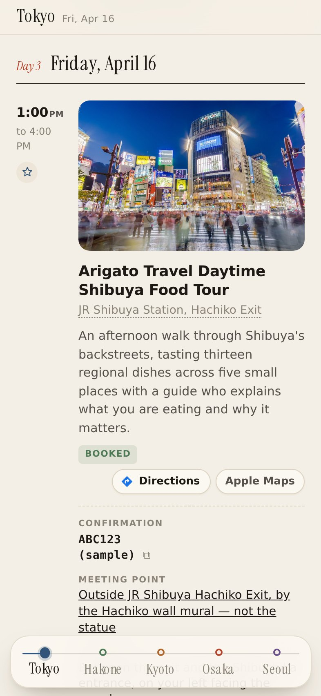

Each day has a heading ("Day 3 · Friday, October 16"). Each event shows its time (and end or arrival), a small icon for
what it is (plane, train, bus, car, bed, bowl, bag, star), a photograph when there is one, the title, the place (tap:
Apple Maps search), a short blurb, a "Booked" or "Don't miss" tag, the Directions buttons, the facts, the confirmations,
and the original itinerary notes folded away under "Itinerary notes".

### The menu, and the weather at a glance

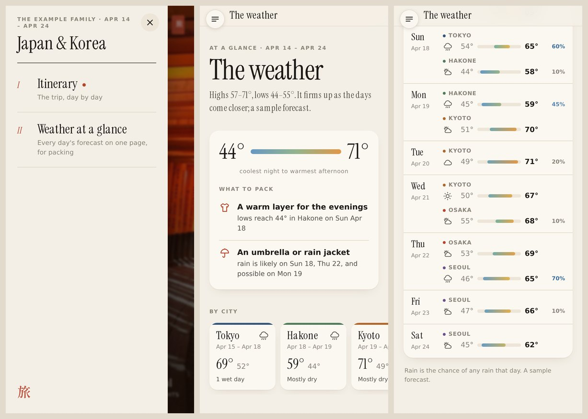

The round button at the top left (☰) opens a menu of **views**: other looks at the same trip. The itinerary is the
first; the second is **Weather at a glance**, made for packing:

- the trip's whole range, from the coolest night to the warmest afternoon, as one bar;
- **What to pack**, said plainly from the numbers: a warm layer when lows reach the low 50s °F, light clothes when
  highs pass the mid 70s, an umbrella when rain is likely (with the days and places);
- a card per city: its dates, its highest and lowest, how many wet days;
- every day's forecast as a row with a range bar on one shared scale, like a good weather app's ten-day view (both
  cities on a travel day; days beyond the forecast say so).

Each view has its own address (`#weather`), so the phone's back gesture and a bookmark both work. Section 10 shows how to
add a view of your own.

### The phrasebook, with sound

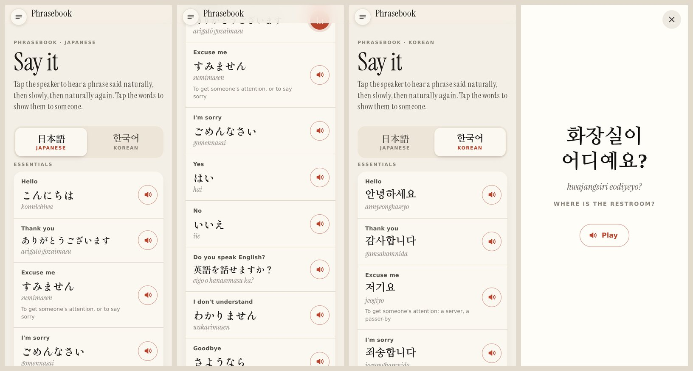

The third view: the everyday phrases (essentials, getting around, eating out, shopping, the hotel, help) in each
language of the trip, the one for the country you are in shown first during the trip. Each phrase shows its English,
the phrase in its own script (in the same brushed serif as the cover's city names), and a romanization to read aloud.

- **Tap the speaker** to hear it: said naturally, then slowly with every sound exaggerated so you can copy it, then
  naturally again. The phrase is said by Gemini's text-to-speech in a native voice for the language (standard Tokyo
  Japanese, standard Seoul Korean, …), and every recording is checked by a second model that listens and says whether
  it heard exactly that phrase.
- **Tap the words** for a full-screen card to hold up for someone (a taxi driver, a waiter), with the natural recording.
- It all works offline: the recordings are small AAC files inside the app (the sample's 64 phrases are about 4 MB).

You write the phrases (`phrases.json`, section 5) and `pipeline/phrase_audio.py` makes the sound (section 6). Without
sound the phrasebook still works as text.

### The weather, day by day

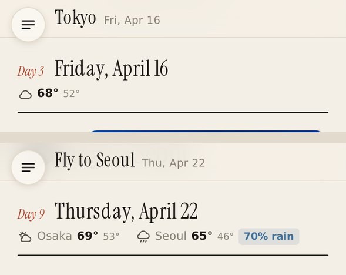

Under each day's heading: the forecast where you are that day: an icon, the high and the low, and the chance of rain
when it is 30% or more. On a travel day, both cities (where you wake up, then where you sleep). It comes from
[Open-Meteo](https://open-meteo.com) (free, no key), at the hotels' own coordinates when `places.py` has found them,
otherwise the city's. Forecasts reach about 16 days ahead, so days further out simply have none until they come into
range; rebuild nightly (section 8) and they fill in and sharpen. The end page credits Open-Meteo and says when the
forecast was fetched. Leave it out with `--no-weather`, or give your own (`weather` in trip.json, section 5).

### Directions, exact places, and the offline map

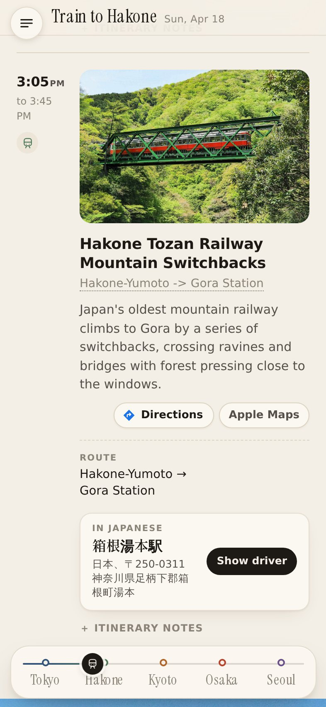
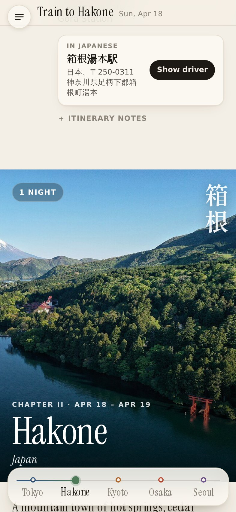

- **Directions** opens Google Maps with directions from wherever the phone is to the exact place (by Google's place
  id, so a text search cannot land somewhere similar). In South Korea the button becomes **Naver Map**, because Google
  cannot give walking or transit directions there.
- **Apple Maps** opens Apple Maps by coordinates; with the area downloaded beforehand, that works with no network.
- Below the facts, when the place was looked up: a small **map** in the brochure's colours (tap: Apple Maps), and the
  place's **name and address in the local script**, from Google itself, not a translation.
- **Show driver** fills the screen with that name and address in large type plus "please take me here" in the local
  language, for taxis.

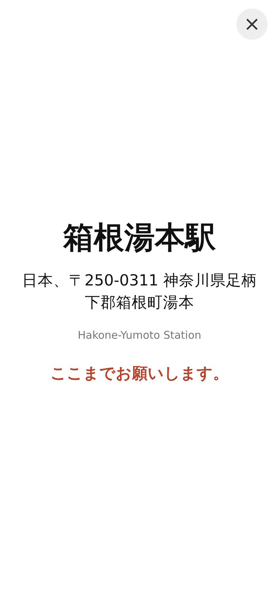

Confirmation numbers and codes are shown in a monospace face; tap one to copy it.

### Confirmations: emails, tickets, screenshots, PDFs

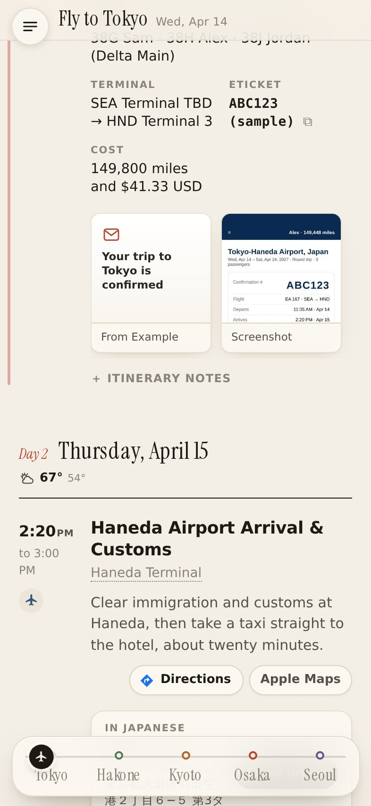

Under an event, its confirmations sit as a row of little papers: an email shows its subject, a screenshot or PDF shows
its top. Tap one to open it full screen.

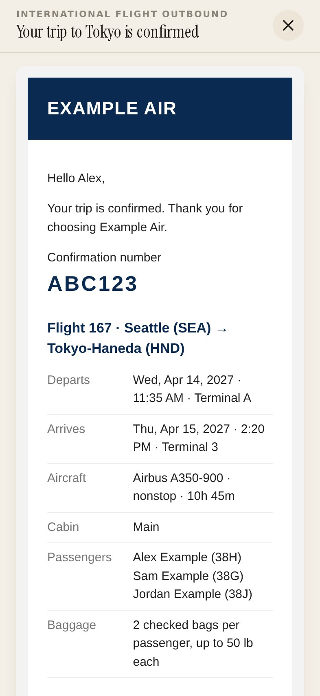
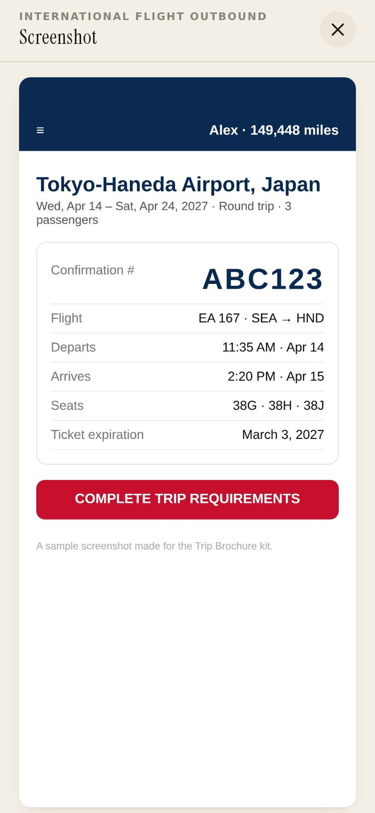
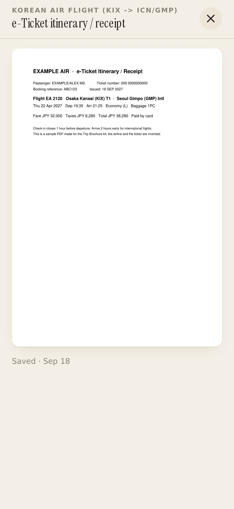

An email is shown as it was sent (its own layout and pictures, made safe and self-contained); a screenshot or a PDF's
pages as images, tap to zoom. The original's sender and date sit at the bottom.

### Emails in other languages, with an English copy

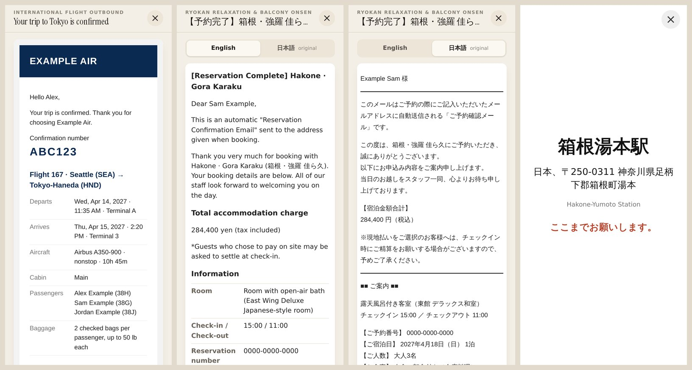

A confirmation in Japanese (or Korean, or anything else) opens in **English**, with the **original** one tap away,
for showing to someone at a check-in desk. The translation keeps every name, number, price and code exactly as written.

### The route dock

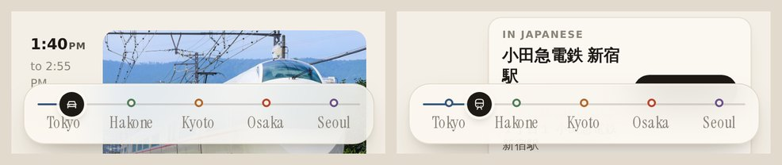

Once the cover scrolls away, the route docks at the bottom of the screen in a frosted bar: the five cities on a line.
The line fills in each city's colour up to where you are reading; the city you are in is highlighted. Through each
journey a **rider** (a plane, a train, a bus, a car; it changes vehicle leg by leg) travels the line as you scroll,
then settles onto the next city's dot. Tap any city to go there. It drops away at the end page and while a document is
open.

### On the road: today, now, next

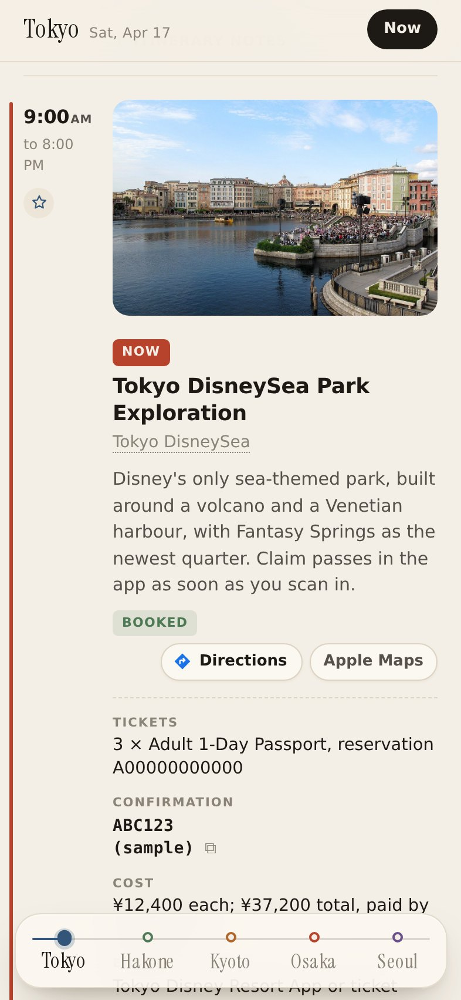

During the trip the app opens on what is happening now (or what is next), marks it "Now", fades what is done, badges
today's heading, and offers a **Now** button in the top bar. Every event is placed in absolute time: the departure in
the home time zone, the landing in the destination's, so it does not matter whether the phone has switched zones yet.
Come back after ten minutes away and it returns to "now"; otherwise you can scroll anywhere.

Add `?now=2027-04-17T10:30` to the page's address to preview any moment (the time is read in the trip's zone).

### Dark mode, iPad, updates, the end

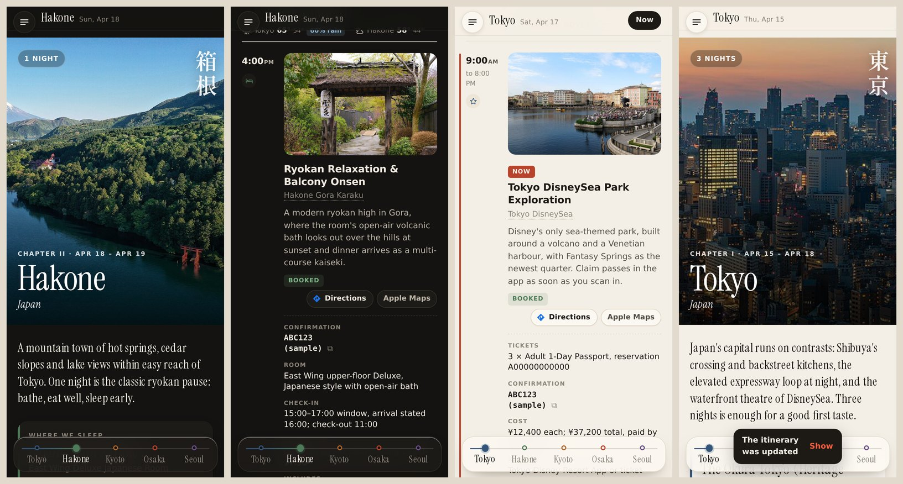

The app follows the phone's dark mode (ink on dark paper, the photographs unchanged). On an iPad or a wide window, an
event's photograph sits beside its words. When a new version of the itinerary has been downloaded, a toast says so
with a **Show** button; the app keeps working on the old version until you tap it.

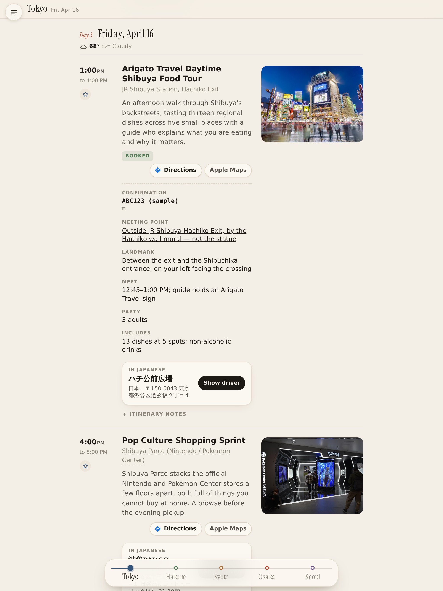
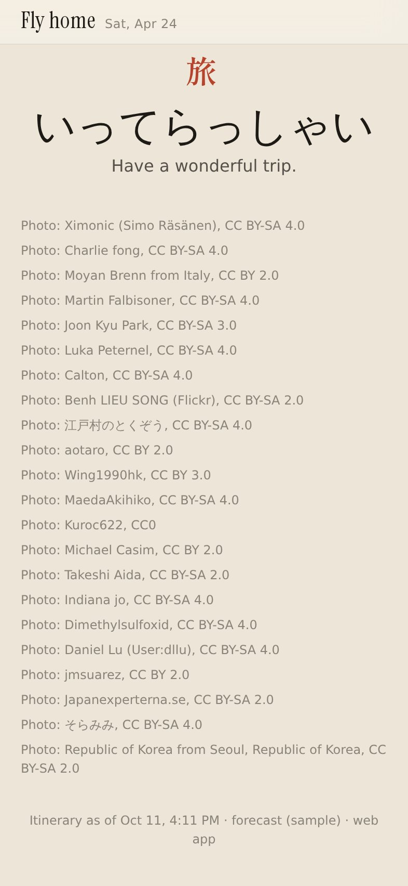

The last page: the seal, a farewell in the local language, photo credits, and when the itinerary was last updated.

---

## 3. How it is put together

```
   you describe the trip                 the builder                          the phones
 ┌──────────────────────┐          ┌──────────────────────┐          ┌─────────────────────────────┐
 │ mytrip/              │          │ build.py             │          │ Route A: web app            │
 │   trip.json          │ ───────▶ │  photos → 1280/500px │ ───────▶ │   any HTTPS static host     │
 │   photos/*.jpg       │          │  PDFs/emails → pages │  dist/   │   "Add to Home Screen"      │
 │   docs/*.eml|pdf|png │          │  data.js, manifest   │          │   sw.js keeps it offline    │
 │   maps/*.png (opt.)  │          └──────────────────────┘          ├─────────────────────────────┤
 └──────────────────────┘                    ▲                       │ Route B: native iOS         │
            ▲                                │                       │   depot/ serves versions    │
   optional, before building:                │ app/ (the page)       │   shell-ios/ wraps the page │
   pipeline/brochure_copy.py (Claude)        │  index.html app.css   │   installs over the air     │
   pipeline/translate.py  (Claude)           │  app.js sw.js fonts   └─────────────────────────────┘
   pipeline/places.py     (Google Maps)
   pipeline/read_confirmation.py (Claude)
   pipeline/design.py     (Claude: name, icon, colours)
   pipeline/phrases.py    (Claude) → phrase_audio.py (Gemini)
```

| Folder | What it is | Needs |
|---|---|---|
| `app/` | The page: `index.html`, `app.css` (the look), `app.js` (everything it does), `sw.js` (offline for the web-app route), `manifest.webmanifest`, `fonts/`. Edit these to restyle or add features. | a browser |
| `build.py` | Trip folder → `dist/`, with each day's forecast from Open-Meteo. | Python 3.10+, `pillow`, `pymupdf`, `beautifulsoup4`, `requests` |
| `sample/` | A complete trip: `trip.json`, photos, four invented documents, an icon. | — |
| `pipeline/` | Optional helpers that write into `trip.json`. | an Anthropic API key; a Google Maps key |
| `depot/` | Optional: a small server (Docker) that holds published versions and the iOS install page. Only for Route B. | Docker, or Python |
| `web-host/` | Optional: nginx in Docker to serve `dist/` from a NAS or a Mac. Route A. | Docker |
| `shell-ios/` | Optional: the native iOS shell (five Swift files), its project template, the Mac build script, the icon. Route B. | a Mac with Xcode |

The page reads one global, `window.TRIP`, from `data.js`. `data.js` is written by the builder from `trip.json`;
you never edit it by hand. `manifest.json` lists the version and every file with its SHA-256; both update routes use
it to fetch only what changed.

---

## 4. Run the sample in five minutes

On any computer with Python 3.10 or newer (a Mac has it; `python3 --version` to check):

```bash
git clone <this repository> trip-brochure && cd trip-brochure
python3 -m venv .venv && source .venv/bin/activate          # optional but tidy
pip install pillow pymupdf beautifulsoup4 requests
python3 build.py sample/
cd sample/dist && python3 -m http.server 8000
```

Open http://localhost:8000 in a browser and narrow the window to phone width (or use the browser's device toolbar).
Scroll. Tap things. Add `?now=2027-04-17T10:30` to the address to see the trip in progress.

On a phone on the same Wi-Fi, open `http://<your computer's IP>:8000` to see it at real size. (Over plain http the
offline part is off; that needs HTTPS, see Route A. Everything else works.)

---

## 5. Describe your own trip

Copy `sample/` to `mytrip/` and edit `mytrip/trip.json`. It is one JSON file; your Claude agent can write it for you
from a spreadsheet, a list of bookings, or a conversation. Every field is described here. Dates are `YYYY-MM-DD`,
times `HH:MM` (24-hour, local to where the event happens).

### The trip itself

```json
{
  "name": "Japan & Korea",
  "title_html": "Japan <i>&amp;</i><br>Korea",
  "family": "The Example family",
  "seal": "旅",
  "farewell": {"native": "いってらっしゃい", "english": "Have a wonderful trip."},
  "intro": "{nights} nights, {cities} cities, two countries: from the neon of <em>Tokyo</em> to …",
  "accent": "#b8432c",
  "accent_dark": "#e0694f",
  "start": "2027-04-14",
  "end": "2027-04-24",
  "people": ["Alex", "Sam", "Jordan"],
  "zones": {"default": "+09:00", "Seattle": "-07:00"},
  "timezone": {"default": "Asia/Tokyo", "home": "America/Los_Angeles"},
  "bundle_id": "com.example.tripbrochure",
  "cover": {"file": "photos/fushimi.jpg", "focus": "50% 40%", "credit": "…", "license": "CC BY-SA 4.0", "page": "https://…"}
}
```

| Field | Meaning |
|---|---|
| `name` | The trip's name: the page title, the app's name. |
| `title_html` | Optional. The cover title with its own line breaks and italics (HTML). Defaults to `name`. |
| `family` | Optional. The small line at the top of the cover. |
| `seal` | Optional. One character for the seal on the cover and the end page (set vertically for Chinese, Japanese or Korean; a short word in any other script is set across, in italics). Leave out for none. |
| `farewell` | Optional. The end page's big line (`native`) and its translation (`english`); `lang` (optional) is the native line's language code, else the phrasebook's first language. |
| `intro` | Optional. The paragraph under the cover (HTML allowed: `<em>` for the accent colour). `{nights}` and `{cities}` are filled in with the numbers, so the line stays true as the trip changes. Defaults to a plain count. |
| `accent`, `accent_dark` | Optional. The one accent colour (links, buttons, the seal, `<em>`), for light and dark mode; written to `theme.css`. Defaults to vermilion. `design.py` picks them for the trip. |
| `cover_match` | Optional. A few words from the title of the event whose photograph should be the cover, when `cover` is not given. |
| `home` | Optional. Where you live (`design.py` gives it a colour, and the city's colour key). |
| `app` | Written by `design.py`: `{"title": "…", "product": "…"}`, the native app's home-screen name and internal name (copy into `shell-ios/apps/*/app.json`, or pass `--shell-app`). |
| `start`, `end` | The first and last day. Every event's date must fall inside. |
| `people` | Who is going; shown on the cover. |
| `zones` | UTC offsets by city name (the first word matters: "Seattle -> Tokyo" uses Seattle's). `default` covers every city not listed. Daylight saving: write the offset in force during the trip. |
| `timezone` | IANA zones: `home` is used until the first event starts, `default` after (for "today"). |
| `bundle_id` | The app's id, used in Naver Map links. Match `shell-ios/apps/*/app.json` if you build the native app. |
| `cover` | The cover photograph (see photographs below). Defaults to the photo of the event `cover_match` names, else the first city's. |
| `please` | Optional. Overrides or adds the "please take me here" line by language code: `{"zh": "请带我去这里。"}`. |
| `languages` | Optional. Names for language codes not already known: `{"id": "Indonesian"}`. |
| `units` | Optional. `"celsius"` for the forecast in °C; °F otherwise. |
| `weather` | Optional. A forecast of your own instead of Open-Meteo's: `{"sample": true, "days": {"2027-04-15": [{"city": "Tokyo", "code": 2, "hi": 67, "lo": 53, "rain": 10}]}}`. `code` is a [WMO weather code](https://open-meteo.com/en/docs#weather_variable_documentation) (0 clear, 1–2 partly cloudy, 3 cloudy, 45 fog, 51–57 drizzle, 61–67 rain, 71–77 snow, 80–82 showers, 95+ thunderstorms). The sample uses this, since its dates are beyond any forecast. Leave it out for the real thing. |

### Cities

```json
"cities": {
  "Tokyo":  {"country": "Japan", "native": "東京", "color": "#34557a", "blurb": "Japan's capital runs on contrasts…", "photo": {…}},
  "Hakone": {"country": "Japan", "native": "箱根", "color": "#4f7a5a", "blurb": "…", "photo": {…}}
}
```

One entry per city you sleep in, keyed by the exact name used in `hotels[].city`. `native` is the name in the local
script (down the side of the chapter's photo); `color` is the city's colour everywhere (its dot, its ribbon, the dock's
line); `blurb` the chapter's paragraph; `lat`/`lng` (optional) pin the city for the forecast when its name alone is
ambiguous (a "Portland" or a small town). All optional except the key; `pipeline/brochure_copy.py` writes `blurb` and `native`
for you, and the app picks a colour if you give none.

### Hotels (stays)

```json
"hotels": [
  {"id": "H-01", "city": "Tokyo", "country": "Japan", "start": "2027-04-15", "end": "2027-04-18",
   "name": "The Okura Tokyo (Heritage Wing)", "room": "Heritage Twin Junior Suite", "booking": "Amex Fine Hotels + Resorts",
   "perks": "Free breakfast for 3, $100 credit, guaranteed 4 PM checkout", "confirmation": "ABC123",
   "address": "2-10-4 Toranomon, Minato-ku, Tokyo", "blurb": "…", "facts": [{"label": "Includes", "value": "…"}],
   "notes": "anything else, used by brochure_copy.py", "dest": "optional Maps search", "gplace": {…}}
]
```

In order of the trip. `start` is check-in day, `end` check-out day; the nights are the days between. The chapters,
their order and the journeys between them are all derived from this list, so the hotels are the spine of the whole app.
A night with no hotel (an overnight flight, a night train) simply has no chapter; its events fall into the journey.

### Events

```json
"events": [
  {"id": "E-01", "date": "2027-04-14", "start": "11:35", "end": "14:20", "title": "International flight outbound",
   "place": "SEA Airport", "type": "Transit", "city": "Seattle -> Tokyo", "status": "booked", "confirmation": "ABC123",
   "address": "", "cost": "", "notes": "Cross the date line. Rest on the plane.",
   "blurb": "…", "facts": [{"label": "Seats", "value": "38G Sam · 38H Alex · 38J Jordan"}],
   "dest": "Seattle-Tacoma International Airport, Seattle, Washington, USA", "gplace": {…},
   "photo": {"file": "photos/x.jpg", "focus": "50% 50%", "credit": "…", "license": "…", "page": "…"},
   "docs": ["flight", "flight-app"]}
]
```

| Field | Meaning |
|---|---|
| `id` | Any unique string. Keep it stable: documents and links refer to it. |
| `date`, `start`, `end` | `end` may be empty. For a flight that lands the next day, `end` is the landing time in the destination's zone; the app works out that it is the next day. |
| `title`, `place` | What and where. `place` is also an Apple Maps search when there is no exact place. |
| `type` | `Transit`, `Lodging`, `Activity`, `Food`, `Logistics`. Transit events form the journeys and get the plane/train/bus/car icon (worked out from the title and place). |
| `city` | The city, or `A -> B` for travel between cities (then the time zones of A and B apply to start and end). |
| `status` | `booked` (green tag), `critical` ("Don't miss" tag), anything else (no tag). |
| `confirmation`, `cost`, `address`, `notes` | Shown as facts / folded notes; also what the Claude helpers read. |
| `blurb`, `facts` | The copy. Write them, or let `brochure_copy.py` write them. Facts are `[{label, value}]`, at most about seven. |
| `dest` | Where "Directions" goes: a Google Maps search ending in city and country, or an `https://` link (an operator's own map pin). `places.py` can pick these with Claude. |
| `gplace` | The exact place, written by `places.py`: `{id, name, address, lat, lng, local_name, local_address, language, map}`. You can also write one by hand with coordinates and no `id`. |
| `photo` | Optional photograph (see below). |
| `docs` | Ids of this event's documents (below). |

### Documents (confirmations)

```json
"docs": {
  "flight":     {"kind": "email", "file": "docs/flight.eml", "subject": "…", "sender": "…", "received": "2026-09-18T17:09:00Z"},
  "flight-app": {"kind": "file",  "file": "docs/flight-app.png"},
  "ryokan":     {"kind": "email", "file": "docs/ryokan.html", "translation": "docs/ryokan.en.html", "language": "日本語", "language_en": "Japanese"},
  "eticket":    {"kind": "file",  "file": "docs/eticket.pdf", "attachments": []}
}
```

- `kind: "email"` with an `.eml` file is best: the builder takes the subject, sender, date, the HTML with its inline
  pictures, and any PDF or image attachment. To get an `.eml`: in Gmail open the message → ⋮ → *Show original* →
  *Download Original*; in Apple Mail, *File → Save As… → Raw Message Source*. An `.html` or `.txt` file works too.
- `kind: "file"` is a screenshot (PNG/JPEG) or a PDF: shown as pages, with a thumbnail of the first.
- `attachments` lists extra files shown after the email's own text. `translation` points at an HTML fragment in
  English (`translate.py` writes it; or write your own); `language` is the native name shown on the toggle.
- Pictures an email loads from the web are fetched once while building and kept locally (`--no-remote` to skip).
  Tracking pixels, scripts and forms are stripped.

### The phrasebook (`phrases.json`)

Optional: a file next to `trip.json`. Languages by code, sections, phrases:

```json
{
 "languages": {"ja": {"name": "Japanese", "native": "日本語", "countries": ["Japan"]},
               "ko": {"name": "Korean", "native": "한국어", "countries": ["South Korea"]}},
 "sections": [
  {"key": "essentials", "title": "Essentials", "phrases": [
   {"en": "Thank you", "ja": ["ありがとうございます", "arigatō gozaimasu"], "ko": ["감사합니다", "gamsahamnida"]},
   {"en": "Excuse me", "ja": ["すみません", "sumimasen", "To get someone's attention, or to say sorry"],
                       "ko": ["저기요", "jeogiyo", "To get someone's attention: a server, a passer-by"]}
  ]}
 ]
}
```

Each language's entry is `[phrase, romanization, note]` (the note optional, and per language: the same English can
need different advice). `countries` decides which language opens first, from the hotel's `country` on the day.
`pipeline/phrase_audio.py` turns entries into objects with `audio` and `learn` file paths. A language may carry a
`voice_style` (how a native speaker from where you are going speaks it), which `phrase_audio.py` uses for its
recordings; `pipeline/phrases.py` writes the whole file, styles included, for your trip's languages.
`sample/phrases.json` has 32 phrases in Japanese and Korean to start from. Keep phrases polite and short; check them with a speaker if you can (or
ask Claude, and listen to the recordings).

### Photographs

Any JPEG or PNG in the trip folder. `focus` is a CSS object-position ("50% 50%" is the middle; "68% 50%" keeps the
right side when the picture is cropped). `credit`, `license` and `page` go on the end page. Pictures are resized to
1280 px (and 2400 px for the cover) and 500 px, so put in the best you have.

Where ours came from: Wikimedia Commons, searching for each place and keeping only "Featured" or "Quality" pictures
in landscape, 1800 px or wider, under CC licences. Your agent can do the same, or use your own photographs.

### Build it

```bash
python3 build.py mytrip/                # → mytrip/dist
python3 build.py mytrip/ --fonts        # once: re-fetch the fonts, subset to your trip's own characters (needs network)
python3 build.py mytrip/ --weather      # fetch a fresh forecast now (otherwise one under 20 hours old is reused)
```

The builder prints every document as it goes and ends with the version. `mytrip/dist` is the whole app; open
`index.html` through a local server as in section 4. Rebuild whenever `trip.json` or a file changes; documents and
remote pictures are cached in `mytrip/.cache`, so rebuilds are quick.

About fonts: `app/fonts` holds the serif (Instrument Serif) whole, and the Japanese and Korean faces subset to the
sample's words (東京, 箱根, 京都, 大阪, 奈良, 日本, 旅, 韓国, 서울, 한국). Any other character falls back to the phone's own
font, which looks fine on iOS and Android. `--fonts` rebuilds the subsets from your `seal`, `farewell` and cities'
`native` strings.

---

## 6. Optional pieces: Claude and Google Maps

All of these are scripts in `pipeline/` that read and write `mytrip/trip.json`. Run them before building. They cache
what they have done (`mytrip/.cache/pipeline.json`), so running one again only works on what changed. Skip any you do
not want: the app shows whatever is in `trip.json`.

```bash
pip install -r pipeline/requirements.txt
export ANTHROPIC_API_KEY=…        # console.anthropic.com → API keys
export GOOGLE_MAPS_KEY=…          # only for places.py
```

### `brochure_copy.py` — the brochure copy (Claude)

Writes a `blurb` and `facts` for every city, hotel and event that has none, and the city's `native` name. The prompt
asks for warm, precise, present-tense copy, no exclamation marks, at most two sentences; and for facts taken **only**
from the item's own text (notes, confirmation, address), never invented. It writes in batches of ten. For the sample's
45 items this was two calls, well under a dollar.

Read the facts once before the trip; they go on the phones. Anything you write yourself in `trip.json` is kept
(`--force` rewrites everything).

### `translate.py` — English copies of foreign emails (Claude)

For each email document not yet marked, Claude decides the language; if it is not English it writes
`docs/<id>.en.html` and sets `translation`, `language` and `language_en`. Names, numbers, dates, prices and codes are
kept exactly as written. The app then shows the English first with the original one tap away.

### `places.py` — exact places and offline maps (Google Maps, optionally Claude)

Two steps. First, if an event has no `dest`, Claude picks one ("where do they have to GO for this": the departure
station for a train, the venue otherwise, ending in city and country). Then Google's **Places API (New)** resolves each
`dest` to its exact place (id, coordinates, name and address in the local script) and the **Maps Static API** draws a
small map of it into `mytrip/maps/`. Hotels are looked up by name and city.

Getting a key (five minutes): go to https://console.cloud.google.com, create a project, turn on billing
(https://console.cloud.google.com/billing), then enable the two APIs (search "Places API (New)" and "Maps Static API"
under *APIs & Services → Library*), then *APIs & Services → Credentials → Create credentials → API key*, and restrict
the key to those two APIs. Google gives a monthly free allowance that covers a trip many times over; set a budget
alert anyway.

**Read the list the script prints.** A search like "Incheon Airport Terminal 2" once resolved to the terminal's
parking lot; "Studio Escape, Osaka" to the wrong branch. Fix a wrong one by editing the event's `dest` in `trip.json`
(a more exact search, or an `https://` link from the operator) and running again. The script never overwrites a
`dest` you wrote.

Why no cached turn-by-turn directions: Google's routing APIs do not return transit routes in Japan, and no walking or
driving routes in Korea, so there is nothing trustworthy to store. The app instead stores the exact place, which the
phone's map apps turn into directions, offline where the map app allows it (Apple Maps with a downloaded area; Google
Maps offline does driving only; in Korea, Naver Map).

### `read_confirmation.py` — file a confirmation on the itinerary (Claude)

```bash
python3 pipeline/read_confirmation.py mytrip/ docs/delta.eml            # prints what it found
python3 pipeline/read_confirmation.py mytrip/ docs/delta.eml --apply    # fills events, registers the document
```

Claude reads a screenshot, PDF or `.eml` (it can see images and PDFs), lists every booking in it (a round trip is
two), and matches each to an existing event or adds a new one (`C-…`). With `--apply` the blank fields of matched
events are filled, confirmation numbers appended, the document registered under `docs` and linked. Your copy of the
original stays where it was.

### `phrases.py` — the phrasebook, written for your trip (Claude)

```bash
python3 pipeline/phrases.py mytrip/        # writes mytrip/phrases.json (asks before replacing one)
```

From the hotels' cities and countries, Claude decides which languages a visitor needs (none where English is the
everyday language: then the app simply has no phrasebook) and writes 32 everyday phrases in six sections (essentials,
getting around, eating out, shopping, the hotel, help) the way a polite local says them, in the local variety
(European Portuguese in Lisbon, Mexican Spanish in Mexico City), with a romanization or an English-speaker's
pronunciation guide and a note where one matters. A phrase that makes no sense there is swapped for the nearest
useful one. Each language also gets a `voice_style` for the recordings. It runs at high effort, a few cents. Read the
result once, with a speaker if you can: a wrong phrase is worse than none. Then run `phrase_audio.py`.

### `design.py` — the app's name, icon and colours (Claude)

```bash
pip install playwright && playwright install chromium     # it renders its own drafts
python3 pipeline/design.py mytrip/                       # icon.png + the design into trip.json
python3 pipeline/design.py mytrip/ --shell-app trip      # also the native app's icon and name
python3 pipeline/design.py mytrip/ --again               # reconsider it after the trip changed
```

A designer agent gives the trip its own app. Claude studies the trip, then works like a designer at a desk: it draws
three different icon concepts as SVG, sees them rendered side by side and at real size on an iPhone home screen with
the app's name under them, and judges them by four tests: does it read in a blink at 60 pt; would someone who knows the
place feel it is this trip, or could it pass for a weather, swimming or banking app; is it crafted (proportions,
balance, every curve, a confident palette); would it hold its own beside the finest apps. It refines the strongest,
rendering after each change, then hands over the icon (`icon.png`, 1024 px, opaque) and writes into `trip.json`: `name`,
`app` (home-screen name, at most 12 characters, and internal name), `title_html`, `seal`, `intro`, `farewell`, `accent`
and `accent_dark`, a `color` for each city and for home, and `cover_match`. Its reasoning is kept in `design.why`.


It takes three to five minutes and costs roughly $1–3 with Claude Opus (adaptive thinking, up to eight renders, each
render a couple of images). Review it before building: open `icon.png`, read the words, build and look at the cover.
If something is off, run it again (each run explores afresh) or edit `trip.json` by hand. With `--again` it sees its
earlier design and keeps the icon and names unless they now misrepresent the trip (a second country booked, say), since
a new icon or name means reinstalling the native app; the words and colours, which only live in the page, are brought
up to date either way. The sample keeps its hand-made design; the picture above is what the designer made of it.

### `phrase_audio.py` — the phrasebook's sound (Gemini)

```bash
export GEMINI_API_KEY=…        # aistudio.google.com → Get API key (free tier works; paid is faster)
brew install ffmpeg            # once
python3 pipeline/phrase_audio.py mytrip/
```

For every phrase without sound: two recordings with **Gemini 3.8 Flash TTS**, one natural and one slow with exaggerated
pronunciation, in a native voice and accent for the language (the voices and accents are a table at the top of the
script: Japanese, Korean, Mandarin, Thai, Vietnamese, French, Spanish, Italian, German, Portuguese and Greek are set up;
a language's `voice_style` in `phrases.json` overrides the table, and any other language gets a neutral standard accent). The accent and pace go in the API's `speech_metadata` style, not in
the text: the 3.8 models read any direction in the text aloud. **Gemini 3.6 Flash** then listens to each recording and
says whether it heard exactly the phrase, naturally pronounced; a rejected one is made again (the last try in another
voice). The two recordings are kept as `audio/<key>.m4a` and joined (natural, pause, slow, pause, natural) into
`audio/<key>-learn.m4a`. About 12 seconds per phrase, a few cents for a whole phrasebook. Run it again after adding
phrases; it only makes what is missing (`--force` for all).

### What we had that you do not need

Our version lived inside a home dashboard with a Gmail connection (confirmations forwarded to a label were filed
automatically), a phone Shortcut that posted screenshots to an inbox, and voice editing. None of that is here, and the
app does not miss it: save confirmations as `.eml` or screenshots into `mytrip/docs/` and run `read_confirmation.py`,
or just write the events by hand. If you want the automation, the pieces to copy are: a mail client that saves new
messages from a label to a folder (Apple Mail rules can run a script; Gmail's API needs OAuth), then
`read_confirmation.py --apply` and a rebuild.

One step further, for an ambitious setup: the original now runs **many trips, each with its own app**. Every
confirmation goes to the same inbox; Claude decides which trip it belongs to (by its dates and places), and one for a
journey no trip covers starts a new trip by itself. A new trip then designs itself (`design.py`'s agent, once the
confirmations stop arriving for a while), gets its phrasebook and its own native app (same shell, a new bundle id,
built by the Mac without anyone at it), and a family dashboard on the wall offers a QR code to install it. Each trip here
is simply its own folder with its own `trip.json`; the rest is plumbing around these scripts.

---

## 7. Getting it onto phones

Pick a route. You can use both at once (the web app for the Android phones, the native app for the iPad).

| | Route A: web app | Route B: native iOS app |
|---|---|---|
| Phones | Android, iPhone, iPad | iPhone, iPad |
| Needs | an HTTPS web address for a folder | a Mac with Xcode, an Apple ID (paid developer account for over-the-air installs) |
| Install | open the address in the phone's browser, "Add to Home Screen" | open an install page in Safari, tap Install (or a cable to the Mac) |
| Offline | yes (a service worker keeps every file) | yes (the files are inside the app) |
| Updates | automatic on next open, "Show" to switch | automatic on next open, "Show" to switch |
| Feels like | an app (full screen, icon); Safari's and Chrome's own quirks apply | an app |
| Effort | half an hour, mostly the hosting | an afternoon the first time |

### Route A: as a web app

1. **Build** the app (section 5): `mytrip/dist/`.
2. **Host that folder somewhere phones can reach over HTTPS.** HTTPS is required: the offline part (the service
   worker) refuses to run over plain http, except on `localhost`. Options, simplest first:
   - **Cloudflare Pages** (free). Install `npm i -g wrangler`, then `wrangler pages deploy mytrip/dist --project-name
     <an-unguessable-name>`. You get `https://<name>.pages.dev`. The address is the only protection, so make the name
     long and random; for real privacy add *Cloudflare Access* (free for a few users: a login by email code in front
     of the site). Redeploy the same command after every build.
   - **Your NAS or Mac mini with Docker** (`web-host/docker-compose.yml`): serves `dist/` on port 8080 on your network.
     Then put HTTPS in front: with **Tailscale** on the NAS and on each phone, `tailscale serve --bg 8080` gives
     `https://<nas>.<your-tailnet>.ts.net`, private to your devices and reachable from anywhere in the world
     (phones must have Tailscale running, which is a fine way to run a family trip app). A **Cloudflare Tunnel**
     (`cloudflared`) is the public alternative.
   - **Netlify / Vercel / GitHub Pages**: all fine for a static folder; GitHub Pages is public and tied to a public
     repository, so keep personal details out or use the others.
3. **On each phone**, open the address in the phone's browser:
   - iPhone/iPad (Safari): tap Share → **Add to Home Screen** → Add. Open it from the icon once while online; from
     then on it works offline.
   - Android (Chrome): the three-dot menu → **Add to Home screen** (or *Install app* when offered) → Install.
4. **Updates:** build again, deploy the folder again. The next time the app is opened online it fetches only the
   changed files and shows "The itinerary was updated — Show".

Known things on this route: on Android, the **Apple Maps** button does nothing useful (hide it by returning no
`apple` link in `ways()` in `app.js`; Google Maps and Naver links open the apps); on iPhone the web app opens
`maps://` and `nmap://` links fine. Storage: a home-screen web app's files are kept as long as the icon is on the home
screen (iOS clears storage of ordinary Safari tabs after a week of disuse, not of installed web apps). Keep the app
under ~50 MB to be safe; the sample is 8 MB.

### Route B: as a native iOS app

The shell in `shell-ios/` is about 400 lines of Swift: a full-screen web view that serves the page from inside the
app (`app://local/`), checks the depot for a newer version when opened, downloads only the changed files, and swaps
versions atomically. Links out, copying, and the status bar colour go through a tiny bridge the page already uses.
There are no third-party dependencies, no package managers, nothing to keep updated.

What you need, in order:

#### B.1 A Mac, and Xcode

Any Mac that runs a current macOS (a Mac mini is ideal). Xcode is Apple's free development app.

1. Open the **App Store**, search **Xcode**, click Get. It is a very large download: allow for 15–25 GB of disk and
   some time. (If the App Store misbehaves, https://developer.apple.com/download/applications/ has the same thing.)
2. Open Xcode once. Accept the licence. When it offers to install the **iOS platform** (the pieces needed to build
   for iPhones), say yes; if it did not ask, go to *Xcode → Settings → Components* and install iOS.
3. In Terminal, make the command-line tools point at it: `sudo xcode-select -s /Applications/Xcode.app` and then
   `xcodebuild -version` should print Xcode's version.
4. Install **Homebrew** if you do not have it (https://brew.sh, one command), then `brew install xcodegen`. (xcodegen
   writes the Xcode project from `project.yml`, so the project file never has to be edited by hand.)

#### B.2 An Apple ID in Xcode, and which kind of account

*Xcode → Settings → Accounts → + → Apple ID*, sign in. You now have a "team". Which kind decides what you can do:

| | Free Apple ID ("Personal Team") | Apple Developer Program (US$99/year) |
|---|---|---|
| Install on your own phone by cable from Xcode | yes | yes |
| How long the app keeps working | **7 days**, then it must be reinstalled | a year per build |
| Number of apps / devices | 3 apps, your own devices | 100 devices of each kind |
| Install over the air from a web page (what the depot does) | no | yes |
| Install on family members' phones without the cable | no | yes |

For a trip, the free account is only good for trying things out: an app that dies on day 7 of an eleven-day trip is
not useful. Enrol in the program if you want the real thing: https://developer.apple.com/programs/enroll/ with the
same Apple ID (two-factor authentication must be on). Enrolment can also be done from the *Apple Developer* app on an
iPhone. It is usually approved within a day or two; occasionally Apple asks for ID. Once in, find your **Team ID**
(ten characters) at https://developer.apple.com/account → *Membership details*, and put it in
`shell-ios/apps/trip/app.json`.

#### B.3 Register the phones (paid program)

A development build installs only on devices registered to the team. Either:

- plug each iPhone/iPad into the Mac once and run the app from Xcode on it (B.5): Xcode registers it; or
- register them by hand: find each device's **UDID** (connect it to the Mac, open Finder, click the device in the
  sidebar, then click the line of small text under the device's name until it shows "UDID"; right-click → Copy), and
  add it at https://developer.apple.com/account/resources/devices/list → +.

Add every family phone before the final build: a build only covers the devices registered at the time it was made.

#### B.4 The depot (for over-the-air installs and updates)

The depot is the small server in `depot/` that holds the published versions of the content and the app's install page.
Run it on the Mac mini or the NAS with Docker:

```bash
cd depot
echo "APPS_SECRET=$(python3 -c 'import secrets;print(secrets.token_urlsafe(32))')" > .env
echo "PUBLIC_URL=https://depot.example.com" >> .env       # the address phones will reach (see below)
docker compose up -d
curl http://localhost:8137/                                # {"depot":"ok",...}
```

Then publish the built app to it:

```bash
python3 depot/publish.py trip mytrip/dist --depot http://<depot machine>:8137
```

Phones read from `PUBLIC_URL/d/<APPS_SECRET>/trip/…` — a secret path, so the itinerary is not browsable by anyone who
finds the server. Two things need that address to work from the phones:

- **Content updates** can go over plain http on the home network or a Tailscale address (the shell allows it). But a
  phone in Japan is not on your home network, so for updates during the trip the depot needs a reachable address:
  Tailscale on the phones, or a public HTTPS address (Cloudflare Tunnel, or a reverse proxy with a certificate).
- **Installing the app itself** from the install page is an Apple mechanism (`itms-services`) that insists on a
  valid HTTPS address with a real certificate (Tailscale Serve's `*.ts.net` certificates count). Without HTTPS, install
  by cable instead (B.5) and still get content updates over the air.

#### B.5 Build and install

```bash
cd shell-ios
# edit apps/trip/app.json: title, bundle_id (reverse-domain, unique to you, e.g. com.yourname.trip), team (Team ID),
#                          depot_lan (http://<depot machine>:8137/api/depot/trip), version
scripts/build.sh trip              # generates build/trip/TripBrochure.xcodeproj and, if signing works, an .ipa
scripts/build.sh trip --upload     # ...and uploads the .ipa to the depot (paid program + HTTPS depot)
```

The script pulls the newest published content from the depot into the app, so it works offline from first launch.

- **Free account, or no HTTPS yet:** open `build/trip/TripBrochure.xcodeproj` in Xcode, connect the iPhone, pick it
  in the device menu at the top, press ▶ (Run). The first time Xcode will ask to enable **Developer Mode** on the
  phone (*Settings → Privacy & Security → Developer Mode*, toggle, restart) and the phone will ask to trust the
  developer (*Settings → General → VPN & Device Management → your Apple ID → Trust*). Also tick "Automatically manage
  signing" under the target's *Signing & Capabilities* tab if Xcode complains.
- **Paid program with the depot on HTTPS:** after `--upload`, the script prints the install page's address. Open it in
  Safari on each phone, tap Install, then trust the developer as above. Give that address only to the family; it
  contains the secret.

Xcode versions: `build.sh` exports with method `debugging` (Xcode 26's name for a development build). On Xcode 15
or earlier change it to `development` in the script.

The icon: `shell-ios/icon.html` draws one character on a coloured field; `python3 make-icon.py` renders it to
`apps/trip/icon.png` (needs `pip install playwright pillow && playwright install chromium`). Or drop in any opaque
1024×1024 PNG.

#### B.6 How the shell behaves (for your agent, when it wants to change it)

- `ShellConfig.swift`: reads `shell.json` (app name, depot address, background colour) baked in at build time.
- `ContentStore.swift`: versions live in *Application Support/WebShell/bundles/<version>/*; `update()` fetches
  `manifest.json` from the depot, and when newer, assembles the new version (files it already has are cloned, the rest
  downloaded and checked against their SHA-256), then switches `current.json`. The built-in copy is used whenever it
  is newer than anything downloaded (a fresh install) and as the fallback.
- `LocalScheme.swift`: serves `app://local/<path>` from the active version (a real origin, so storage and iframes work).
- `ShellViewController.swift`: the web view; checks for updates when the app becomes active (at most every 15 minutes)
  and on pull-to-refresh; the page ↔ shell protocol:
  - page → shell `window.webkit.messageHandlers.shell.postMessage({...})`: `{ready:true}`, `{open:url}`, `{copy:text}`,
    `{reload:true}`, `{checkUpdates:true}`, `{statusBar:"light"|"dark"}`
  - shell → page `window.dispatchEvent(new CustomEvent("shell", {detail}))`: `{version, content}`, `{contentReady:v}`,
    `{shellUpdate:{version, install}}`, `{checked:"upToDate"|"failed", detail}`

  The page already handles all of these (`app.js`, "the native shell" section), and runs happily without a shell.

### Route C: a native Android app

Not built here. The honest advice: the web app (Route A) on Android is already as good as a wrapper, with an icon,
full screen, offline and updates. If you want a store-less APK anyway, the usual tool is **Capacitor**
(https://capacitorjs.com): `npm init @capacitor/app`, point it at `mytrip/dist`, `npx cap add android`, open in Android
Studio, build an APK, install it by cable or by sending the file. Updates would then be rebuilds unless you add a
content-fetching layer like the iOS shell's `ContentStore`, which your agent could port to Kotlin in an afternoon.

---

## 8. Updating it, before and during the trip

Every update is the same three steps, from any computer:

1. change `mytrip/trip.json` (or drop a new document into `mytrip/docs/` and register it, or run a pipeline script)
2. `python3 build.py mytrip/`
3. publish: Route A, deploy `dist/` again; Route B, `python3 depot/publish.py trip mytrip/dist`

Only changed files travel: the builder names photographs and document pages by content, and both the service worker
and the iOS shell copy what they already hold. A typical itinerary tweak sends a few kilobytes (`data.js` and
`manifest.json`).

On the phones: the next time the app is opened with a connection (the native shell also checks when the app comes to
the front, at most every 15 minutes), the new version is fetched in the background; a toast says "The itinerary was
updated" with **Show**; the old version keeps working until then. Pull down on the native app to check at once.

**The forecast, nightly.** Forecasts change daily, so rebuild and publish once a night: the app then opens each morning
with today's forecast. On the Mac mini, `crontab -e` and add (paths to suit; the deploy line is your route's):

```
0 3 * * *  cd ~/trip-brochure && .venv/bin/python build.py mytrip/ --weather && npx wrangler pages deploy mytrip/dist --project-name <name>
```

or, for Route B, `&& .venv/bin/python depot/publish.py trip mytrip/dist`. Cron runs on the Mac's own clock: during the
trip, a forecast fetched at 3 AM at home is mid-afternoon at the destination. Two lines (a second at the hour that is 3 AM
there) keep it fresh for both. On a NAS, the same lines go in its scheduled tasks (or a cron container). If the network
is down, the build keeps the last forecast.

Changing the **native shell** itself (Swift, the icon, the app's name) is the only thing that needs the Mac again:
bump `version` in `app.json`, `scripts/build.sh trip --upload`; the app then offers "Install" for the new one.
Content changes never need it.

---

## 9. The design, and the rules that keep it looking this way

The look is a printed brochure on warm paper. Keeping it is mostly a matter of not adding things.

### The house style, in every prompt

Every Claude job in `pipeline/` (the designer, the copywriter, the phrasebook writer) is given the same brief,
`pipeline/style.py`, so whatever the trip, and however little of it you write by hand, the result is held to one
standard. Edit that file to change the house's taste; this is it as shipped:

> The family's trip apps are held to the standard of a beautifully printed travel brochure and a best-in-class iPhone app (think Aman, Condé Nast Traveler, Monocle; Apple's own apps): high-end, beautiful, delightful, impeccable. Every detail is considered; nothing generic, clip-art, stock or template-like.
> - Restraint: paper and ink, one accent colour, and the photographs carry the colour. Generous margins: text and card edges never touch the screen's edge; only photographs bleed. Resist adding things; take away what does not earn its place.
> - Type: a refined display serif (Instrument Serif) for titles, the system font for reading; a destination's own script in a fine face of its own (a mincho for Japanese, a myeongjo for Korean); never two typefaces inside one word.
> - Voice: warm and precise, never gushing; present tense; no exclamation marks; facts only from the sources, never invented.
> - Detail: consistent spacing and alignment, balanced line breaks, real typography (curly apostrophes, en dashes for ranges), names spelled as locals spell them, contrast that reads in light and dark mode, at arm's length, in sunlight.
> - Delight: small, purposeful touches (the route dock's little vehicle, a seal in the local script), never decoration for its own sake.
> What every trip's app must do (keep it all working, whatever the trip): work fully offline; open on today's event during the trip (times in each place's own time zone); Directions to the exact place (Google Maps, Apple Maps, Naver in Korea) and a card in the local script to show a driver; every confirmation one tap away (the original email, its PDF, an English translation); weather at a glance with packing notes; a phrasebook with offline audio wherever English is not the language; the route dock; updates over the air; large tap targets, one-handed use.

When your agent writes prompts of its own for this app, it should include the brief too.

### The details

**Colour** (`app.css` `:root`): paper `#f4efe6`, a second paper `#ece5d8`, card `#fbf8f2`, ink `#1d1a16`, two greys
for secondary and tertiary text, a hairline `#ddd3c2`, one accent, vermilion `#b8432c`, and a muted green for "booked".
Dark mode swaps paper for near-black (`#141311`) and ink for off-white; photographs are left alone. Each city has one
colour of its own, used sparingly: its dot, its ribbon, its stretch of the dock's line. Nothing else is coloured.

**Type:** Instrument Serif (free, Google Fonts) for everything display: the cover title, city names, day headings,
numbers at a glance, the hotel's name. The phone's own system sans (San Francisco, Roboto) for everything you read on
the day: titles, blurbs, facts. Small capitals with wide tracking (`.kicker`) for labels. Shippori Mincho / Nanum
Myeongjo for the Japanese and Korean, and a fine face per script for other destinations (Noto Serif SC/TC, Noto Serif
Thai, Noto Serif for Greek, Cyrillic and Vietnamese, Frank Ruhl Libre, Amiri, Noto Serif Devanagari; Latin-script
languages use Instrument Serif), each cut down by `build.py --fonts` to the characters the trip shows, so no word
mixes two typefaces. Confirmation codes in the system monospace. No other faces.

**Layout:** one column, 20 px gutters on a phone (32 on a tablet), content capped at 720 px; photographs and chapter
heroes bleed to the edges, everything else keeps the gutter. Cards have 14–18 px radii and a soft double shadow;
hairlines separate events. Heroes get a dark gradient from the bottom so white type stays legible on any photograph.

**Motion:** little, and physical. The cover's 24-second zoom; the dock's spring (`cubic-bezier(.2,.9,.25,1.15)`) and
its stops arriving one after another; the rider's vehicle popping in; the document viewer sliding up. Everything
respects `prefers-reduced-motion`.

**Rules we kept to** (worth keeping): no exclamation marks in copy; present tense; at most two sentences per blurb;
facts only from the source, never invented; the original document is always one tap away from any summary; nothing
needs the network to render; the sides of a card never touch the screen's edge (text and borders at the edge look
broken; full-bleed photographs do not).

---

## 10. Making it yours: customising and riffing

Things that are a few lines each, all in `trip.json` or at the top of `app.css`:

- **Another country or language:** `zones`, `timezone`, `seal` (any character or none), `farewell`, the cities'
  `native`. `places.py` already speaks Japanese, Korean, Chinese, Thai, Vietnamese, French, Italian, Spanish, German,
  Greek and Portuguese for local names; add a language to `LANG_HINTS` there and to `please` / `languages` in
  `trip.json`. Naver Map is only offered for places whose language is Korean; everywhere else Google Maps leads.
- **Colours and fonts:** the `:root` block in `app.css`; `--serif` for a different display face (drop a `.woff2`
  into `app/fonts` and an `@font-face` into `app/fonts.css`).
- **Cover photograph:** `cover` in `trip.json`; the `focus` moves the crop.
- **A view of your own** (a packing list, a phrasebook, the hotels side by side): add an entry to `VIEWS` in `app.js`
  (`{ title, label, sub, render }`; `render()` returns the page's HTML, and `when()` can hide it while there is nothing
  to show), and it appears in the menu with its own `#address`. `weatherView()` is the worked example: it reads
  `T` (data.js), lays the page out in the same paper, serif and cards, and needs nothing else.
- **Fewer features:** delete what you do not want from `app.js`: `docCards()` (confirmations), `whereHTML()` (maps and
  local names), `wxHTML()` (the forecast; or build with `--no-weather`), the phrasebook (leave out `phrases.json`), the dock (`dockLayout`/`dockMove` and the `#dock` markup), `goNow()` (auto-scroll). Each is
  self-contained.

Ideas we did not build, in rough order of how much they would add:

- A **packing list** or **to-do** view (a second data array, a checklist with ticks saved in `localStorage`), next to
  the weather view in the menu.
- **Per-person details**: seats and ticket numbers by traveller, shown on the event under each name.
- A **"Share to Trip"** iOS Shortcut that saves a screenshot into `docs/` on a shared folder, so a rebuild picks it up.
- **Currency** conversions on costs, fixed at build time.
- A **printable** version: the page already prints acceptably; a `@media print` block would make it a real brochure.
- **Several trips** in one app: a chooser page, one `data.js` per trip.

---

## 11. Troubleshooting

- **The page is blank / nothing renders.** Open it through a local server (`python3 -m http.server`), not by
  double-clicking `index.html` (browsers block scripts on `file://`). Then open the browser console: an error there
  points at the line. Most often it is a `trip.json` problem (a missing `id`, a hotel's `city` not in `cities`, a
  date outside `start`–`end`).
- **`build.py` fails on a document.** PDFs need `pymupdf`; emails need `beautifulsoup4`; an `.eml` that is really an
  HTML file renamed will not parse — rename it `.html`.
- **A photograph is cropped badly.** Adjust its `focus` ("30% 50%" shows more of the left).
- **The web app does not work offline.** The address must be HTTPS. Check in the browser's developer tools that the
  service worker registered (Application → Service Workers), and that `manifest.json` loads.
- **The web app does not update.** `manifest.json`, `sw.js` and `index.html` must not be cached by the host (the
  `web-host/nginx.conf` sets this; Cloudflare Pages does the right thing by default). Pull the app down / reopen it.
- **The native app shows an old itinerary.** It checks on becoming active, at most every 15 minutes: pull down to
  force a check. If "Check for updates" at the bottom says "No connection", the depot address baked into the app is
  not reachable from where the phone is (section B.4).
- **Xcode: "No profiles for … were found" / "Signing requires a development team".** Select the target in Xcode →
  *Signing & Capabilities* → tick *Automatically manage signing* → choose your team. With a free account the team is
  "Your Name (Personal Team)".
- **Xcode: "Untrusted Developer" on the phone.** *Settings → General → VPN & Device Management* → trust.
- **The install page says the app cannot be installed.** The phone is not in the build's provisioning profile:
  register it (B.3) and rebuild; or the address is not HTTPS with a valid certificate.
- **Directions go to the wrong place.** Fix the event's `dest` in `trip.json` and run `places.py` again; for an
  operator's own pin, paste their `https://maps.app.goo.gl/…` link as `dest`.

---

## 12. Credits, licences, costs

- Code: MIT (see LICENSE). Do what you like with it.
- Fonts: Instrument Serif, Shippori Mincho, Nanum Myeongjo, all SIL Open Font License (Google Fonts).
- Sample photographs: Wikimedia Commons, Creative Commons, each credited in `sample/trip.json` and on the app's end
  page. Keep the credits when you use them; replace them freely.
- Sample phrasebook recordings: made with Gemini 3.8 Flash TTS for this kit.
- Sample documents: invented ("Example Air" does not exist). The sample's forecast is invented too (marked "sample").
- Weather: [Open-Meteo](https://open-meteo.com), free for non-commercial use, data under CC BY 4.0: keep the credit on
  the end page.
- What our build cost in services: Claude for copy, translations, destination picking and reading ~20 confirmations,
  about two dollars over the whole project; Google Maps for 40 places and 40 maps, within the free allowance. Open-Meteo forecasts: free. Apple
  Developer Program US$99/year. Everything else free.

---

## 13. A start-here checklist for your Claude agent

Paste this to your agent along with the repository:

> Read HANDBOOK.md in this repository top to bottom. Then:
> 1. Build and open the sample (section 4) so you have seen every feature working.
> 2. Ask me which route to the phones we want (section 7) and whether I want the Claude/Google helpers (section 6);
>    set up only what we pick.
> 3. Create `mytrip/trip.json` from what I give you (section 5): start with `name`, dates, `people`, `zones`, the
>    hotels in order, then events day by day. Ask me for photographs or find CC-licensed ones. Keep ids stable.
> 4. Build, open it at phone width, and look at every day; fix anything that reads or looks wrong before showing me.
> 5. Set up the hosting (Route A) or walk me through Xcode (Route B) one step at a time, waiting for me where a step
>    needs my Apple ID, a payment or a phone in my hand. Never type my passwords or payment details.
> 6. Keep the brochure's look (section 9): one accent colour, the serif for display, no exclamation marks, nothing
>    that needs the network to render.
> 7. For updates, use the three steps in section 8 and tell me what changed.
